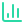
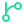
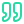

  

  

<a href="#sobre">Sobre</a> &nbsp;·&nbsp;
<a href="#fluxo">Fluxo</a> &nbsp;·&nbsp;
<a href="#metodo">Método</a> &nbsp;·&nbsp;
<a href="#stack">Stack</a> &nbsp;·&nbsp;
<a href="#stats">Estatísticas</a> &nbsp;·&nbsp;
<a href="#contato">Contato</a>

 

##  Sobre mim

Sou desenvolvedor com foco em **Python, pipelines de ETL e análise de dados**. Gosto de pegar dados brutos e espalhados, organizá-los e transformá-los em informação confiável, que ajude alguém a tomar uma decisão melhor.

Hoje curso **Análise e Desenvolvimento de Sistemas** na **FATEC Sorocaba** e coloco em prática o que aprendo em projetos de coleta, tratamento e visualização de dados.

**Foco** &nbsp; Python, ETL e análise de dados 
**Formação** &nbsp; ADS na FATEC Sorocaba 
**Linguagens** &nbsp; Python, SQL, JavaScript 
**Busco** &nbsp; Estágio na área de dados

 

##  Meu fluxo com dados

<table>
  <tr>
    <td width="25%" valign="top">
       
      <b>Extrair</b> 
      Coleta de APIs e sites com Requests e BeautifulSoup, além de planilhas e arquivos.
    </td>
    <td width="25%" valign="top">
       
      <b>Transformar</b> 
      Limpeza, padronização e cruzamento de dados com Pandas e NumPy.
    </td>
    <td width="25%" valign="top">
       
      <b>Carregar</b> 
      Modelagem relacional e consultas SQL em MySQL.
    </td>
    <td width="25%" valign="top">
       
      <b>Analisar</b> 
      Gráficos com Matplotlib e interfaces web para apresentar os resultados.
    </td>
  </tr>
</table>

<!--
  PROJETOS EM DESTAQUE
  Para cada projeto, gere o banner e o botão com:
    python ferramentas/gerar_banner.py "Nome" "Descrição curta" "Python,Pandas,MySQL" nome-arquivo
  Depois copie o bloco abaixo, troque os links e remova este comentário.

##  Projetos em destaque

Duas ou três frases sobre o problema que o projeto resolve, de onde vêm os dados e o que ele entrega.

 
-->

##  Como eu trabalho

<table>
  <tr>
    <td width="50%" valign="top">
       
      <b>Começar pela pergunta</b> 
      Antes do código, entender que decisão os dados precisam apoiar. Isso define o que coletar e o que ignorar.
    </td>
    <td width="50%" valign="top">
       
      <b>Dado limpo antes de dado bonito</b> 
      Tratar valores ausentes, duplicados e formatos inconsistentes antes de qualquer gráfico.
    </td>
  </tr>
  <tr>
    <td width="50%" valign="top">
       
      <b>Código que outra pessoa entende</b> 
      Scripts organizados, nomes claros e README explicando como rodar cada projeto.
    </td>
    <td width="50%" valign="top">
       
      <b>Tudo versionado</b> 
      Git em todos os projetos, com commits pequenos e histórico que conta o que mudou.
    </td>
  </tr>
</table>

##  Stack

<table>
  <tr>
    <td width="150"><b>Linguagens</b></td>
    <td></td>
  </tr>
  <tr>
    <td><b>Dados</b></td>
    <td>
      
      
      
      
    </td>
  </tr>
  <tr>
    <td><b>Coleta</b></td>
    <td>
      
      
    </td>
  </tr>
  <tr>
    <td><b>Front-end</b></td>
    <td></td>
  </tr>
  <tr>
    <td><b>Ferramentas</b></td>
    <td></td>
  </tr>
</table>

##  Estatísticas

  

<picture>
  <source media="(prefers-color-scheme: dark)" srcset="https://raw.githubusercontent.com/gabrieldasilva88188/gabrieldasilva88188/main/assets/gerado/snake-dark.svg" />
  <source media="(prefers-color-scheme: light)" srcset="https://raw.githubusercontent.com/gabrieldasilva88188/gabrieldasilva88188/main/assets/gerado/snake.svg" />
  
</picture>

##  Contato

  

*Sem dados, você é apenas mais uma pessoa com uma opinião.* 
<b>W. Edwards Deming</b>

 

<a href="#topo"> Voltar ao topo</a>

